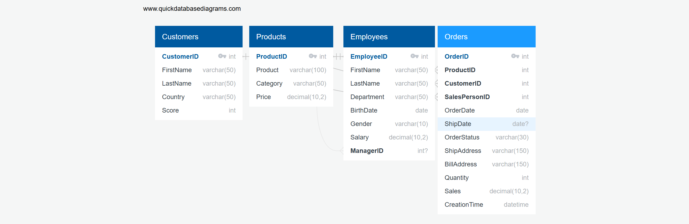

# SQL & Relational Database Design Assignments

**Student:** Elvin Səfiyev  
**Group:** 845İ  
**Course:** SQL & Relational Database Design  

---

## Overview

This repository contains my completed solutions for the Database Design and SQL practical assignments. It includes full SQL scripts for database schema creation, sample record insertion, foundational SQL exercises, scenario-based business queries, and Entity-Relationship Diagrams (ERD).

---

## Repository Structure

- **`SQL_Assignments.sql`**: Complete SQL script containing:
  - **Part I**: DDL statements for `SalesDB`, sample data insertion (`INSERT INTO`), and 10 foundational SQL exercises (Tasks 1–10).
  - **Part II**: 28 scenario-based analytical queries divided into:
    - *Assignment 1*: Customer Loyalty and Sales Analysis (7 tasks)
    - *Assignment 2*: Order and Delivery Investigation (9 tasks)
    - *Assignment 3*: Products and Employee Performance (12 tasks)
  - **Part III**: Schema definitions (DDL) for the University Course Registration system.
- **`Sales_Database_ERD.png`**: Relational database diagram for Assignment 4 (SalesDB).
- **`University_Registration_ERD.png`**: Relational database diagram for Assignment 5 (University Course Registration System).

---

## Assignment 4 — Sales Database (SalesDB) ERD

The SalesDB database models an online retail platform connecting customers, products, sales staff, and orders.

### Key Entities and Keys

1. **Customers**:
   - Primary Key: `CustomerID`
   - Attributes: `FirstName`, `LastName`, `Country`, `Score`
2. **Products**:
   - Primary Key: `ProductID`
   - Attributes: `Product`, `Category`, `Price`
3. **Employees**:
   - Primary Key: `EmployeeID`
   - Foreign Key: `ManagerID` (references `Employees.EmployeeID`)
   - Attributes: `FirstName`, `LastName`, `Department`, `BirthDate`, `Gender`, `Salary`
4. **Orders**:
   - Primary Key: `OrderID`
   - Foreign Keys: `CustomerID`, `ProductID`, `SalesPersonID`
   - Attributes: `OrderDate`, `ShipDate`, `OrderStatus`, `ShipAddress`, `BillAddress`, `Quantity`, `Sales`, `CreationTime`

### Relationship Explanations & Cardinalities

- **Customers to Orders (1:N)**: A single customer can place multiple orders over time, but every order belongs to exactly one customer. Connected via `Orders.CustomerID = Customers.CustomerID`.
- **Products to Orders (1:N)**: A product can appear across multiple customer orders, but each individual order record references one product. Connected via `Orders.ProductID = Products.ProductID`.
- **Employees to Orders (1:N)**: A sales employee can process many orders, while each order is assigned to one sales employee. Connected via `Orders.SalesPersonID = Employees.EmployeeID`.
- **Employees Self-Reference (1:N)**: An employee can report to another employee who acts as a manager. A manager can supervise multiple team members, while an employee has at most one direct manager. Connected via `Employees.ManagerID = Employees.EmployeeID`.

---

## Assignment 5 — University Course Registration ERD

This database manages academic course enrollments, resolving many-to-many relationships between students and courses.

### Key Entities and Keys

1. **Students**:
   - Primary Key: `StudentID`
   - Attributes: `FirstName`, `LastName`, `Email`, `BirthDate`, `Faculty`, `EnrollmentYear`
2. **Instructors**:
   - Primary Key: `InstructorID`
   - Attributes: `FirstName`, `LastName`, `Department`, `Email`, `Salary`
3. **Courses**:
   - Primary Key: `CourseID`
   - Foreign Key: `InstructorID` (references `Instructors.InstructorID`)
   - Attributes: `CourseName`, `Credits`, `Semester`
4. **Enrollments**:
   - Primary Key: `EnrollmentID`
   - Foreign Keys: `StudentID` (references `Students.StudentID`), `CourseID` (references `Courses.CourseID`)
   - Attributes: `EnrollmentDate`, `Grade`, `Status`

### Relationship Explanations & Cardinalities

- **Instructors to Courses (1:N)**: Each course is taught by one instructor, but an instructor may teach multiple courses throughout academic semesters.
- **Students to Enrollments (1:N)**: A student can enroll in multiple courses, resulting in multiple enrollment entries.
- **Courses to Enrollments (1:N)**: A course can have many student registrations, represented by individual enrollment entries.
- **Role of the Enrollments Table**: `Enrollments` functions as an associative (junction) table resolving the many-to-many (M:N) relationship between `Students` and `Courses`. It tracks registration metadata including `EnrollmentDate`, numeric `Grade`, and `Status` (e.g., active, completed).
- **Preventing Duplicate Registrations**: A composite unique constraint `UNIQUE (StudentID, CourseID)` ensures that a student cannot be registered more than once for the same course.

---

## Technologies Used

- **SQL / Relational DBMS**: MySQL / MySQL Workbench
- **Database Modeling**: QuickDBD / Relational Schema Design
- **Version Control**: Git & GitHub
